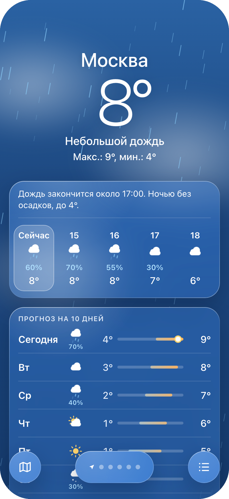
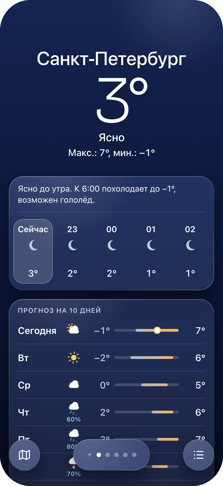
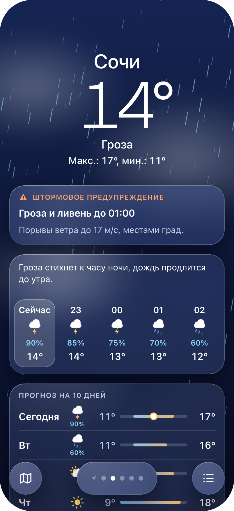
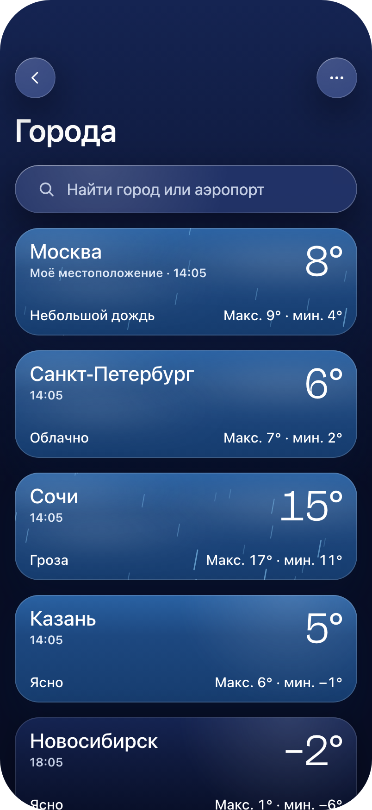
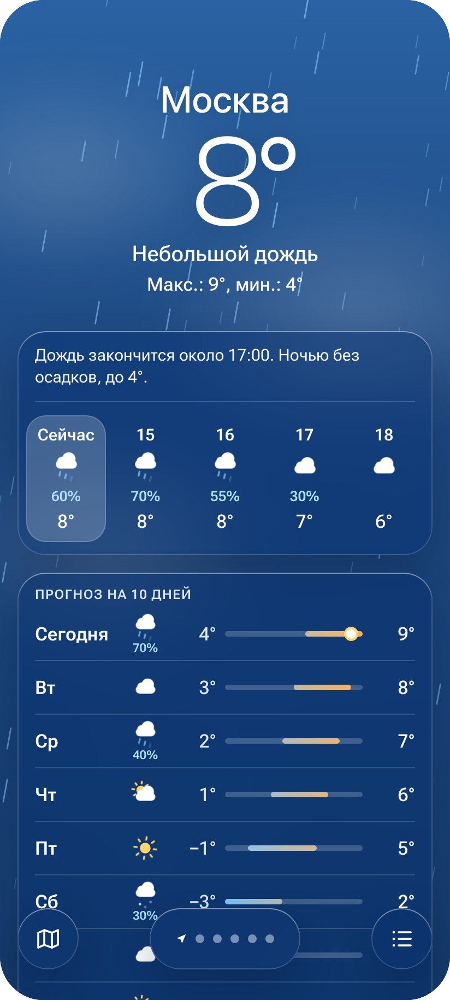
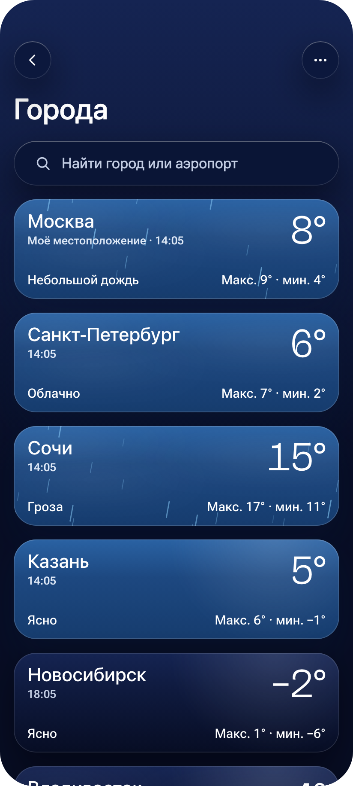

# OneMoreWeatherApp

Погодное приложение для iPhone и Android на Expo и React Native. Небо занимает весь экран и меняется вместе с погодой и временем суток, а данные лежат поверх него на полупрозрачных панелях.

> Это pet-проект для изучения мобильной разработки. Возможны баги и изменения.

## Статус

- Главный экран и список городов работают на настоящих данных [Open-Meteo](https://open-meteo.com/): погода, поиск и добавление городов, переключение городов свайпом.
- При запуске играет анимированная заставка «Восход».
- Пока нет: определения местоположения, правки списка городов, карты осадков, штормовых предупреждений.
- Проверено на симуляторе iPhone и эмуляторе Android, на реальных телефонах не запускалось.

## Скриншоты

Это макеты дизайна, а не снимки приложения. В макетах панели стеклянные (Liquid Glass), в приложении они проще: полупрозрачная заливка без размытия.

<table>
  <tr>
    <td align="center"><br><sub>Главный экран, день</sub></td>
    <td align="center"><br><sub>Ясная ночь</sub></td>
    <td align="center"><br><sub>Гроза и предупреждение</sub></td>
    <td align="center"><br><sub>Список городов</sub></td>
  </tr>
</table>

Тот же дизайн на Android, отличается только системный шрифт.

<table>
  <tr>
    <td align="center"><br><sub>Главный экран</sub></td>
    <td align="center"><br><sub>Список городов</sub></td>
  </tr>
</table>

## Что умеет приложение

- [x] Текущая температура, состояние погоды, максимум и минимум дня.
- [x] Живое небо: дождь, облака, солнце и луна в зависимости от погоды и времени суток.
- [x] Прогноз на ближайшие часы с шансом осадков.
- [x] Прогноз на 10 дней со шкалой температур.
- [x] Плитки «Ощущается как», ветер и другие показатели.
- [x] Список городов с поиском, у каждого города своё небо и своё время.
- [x] Переключение между городами свайпом.
- [ ] Определение местоположения.
- [ ] Карта осадков.
- [ ] Штормовые предупреждения.

Что где находится и по чему можно нажимать, показывает гид по экранам:


## Дизайн

- **Две темы.** День и ночь переключаются по восходу и закату в выбранном городе, а не по теме телефона.
- **Один дизайн для обеих платформ.** Те же экраны, цвета и анимации на iPhone и Android.
- **Панели.** Тёмная полупрозрачная заливка и тонкая светлая кромка. Стекло из макетов (Liquid Glass и размытие) убрано, чтобы код было проще читать.
- **Шрифты.** Цифры температуры набраны Bricolage Grotesque, остальной текст системный: SF Pro на iPhone, Roboto на Android.
- **Анимации.** Дождь и облака в небе, отсчёт температуры при открытии, каскадное появление панелей, шкала температур растёт пружинкой, иконки погоды двигаются. При включённом «Уменьшении движения» всё сводится к простому затуханию.

Все токены, правила и компоненты описаны в дизайн-системе.

## Документация

- [docs/](docs/README.md): видение продукта, пользовательские истории, требования, экраны и навигация, бизнес-правила, риски, глоссарий.
- [docs/tech/](docs/tech/README.md): архитектура, источники данных, UI-спецификация, план и статус задач, тесты.

## Ссылки

| Что | Ссылка |
| --- | --- |
| Дизайн-система | https://claude.ai/artifact/NodGnsQuESKs2RFibsMCiX |
| Макеты экранов и гид | https://claude.ai/artifact/Hv2h29d8ZeGG6SE1KDCpW6 |

Обе страницы приватные: они открываются только у автора. Чтобы показать их другим, нужно дать доступ через меню «Поделиться» на самой странице.

Документация, на которую опирается проект:

- [Expo SDK 58](https://docs.expo.dev/versions/v58.0.0/)
- [Expo Router](https://docs.expo.dev/router/introduction/)
- [React Native](https://reactnative.dev/docs/getting-started)

## Стек

- [Expo](https://expo.dev) SDK 58, React Native 0.88, React 19.3, TypeScript
- [Expo Router](https://docs.expo.dev/router/introduction/): навигация
- [react-native-reanimated](https://docs.expo.dev/versions/latest/sdk/reanimated/): анимации
- [@shopify/react-native-skia](https://shopify.github.io/react-native-skia/): небо (дождь, облака, свечение) и заставка
- [expo-linear-gradient](https://docs.expo.dev/versions/latest/sdk/linear-gradient/): градиент неба
- [react-native-pager-view](https://github.com/callstack/react-native-pager-view): листание городов
- [zustand](https://github.com/pmndrs/zustand) и [expo-sqlite/kv-store](https://docs.expo.dev/versions/latest/sdk/sqlite/): состояние и его хранение на телефоне
- [zod](https://zod.dev): проверка ответов Open-Meteo

## Запуск

Приложению нужен development build: модули с нативным кодом не работают в Expo Go.

```bash
npm install
npm run ios       # собрать и открыть на симуляторе iPhone
npm run android   # собрать и открыть на эмуляторе Android
```

Для Android нужен `ANDROID_HOME` (обычно `~/Library/Android/sdk`).

Проверки:

| Команда | Что делает |
| --- | --- |
| `npx tsc --noEmit` | проверяет типы |
| `npx expo lint` | линтер |
| `npx jest` | тесты |

## Структура

```
.
├── src/
│   ├── app/          экраны (Expo Router): главный, список городов, корневой _layout
│   ├── components/   интерфейс без данных: небо, панели, прогнозы, иконки
│   ├── features/     логика: погода, города, заставка
│   ├── lib/          утилиты: форматирование, HTTP, хранилище
│   ├── theme/        цвета, шрифты, движение
│   ├── i18n/         тексты на русском
│   └── mocks/        данные макетов для тестов
├── scripts/          генерация картинки заставки
├── assets/           иконки и картинка заставки
├── app.json          настройки приложения Expo
├── CLAUDE.md         контекст проекта для Claude Code
└── docs/             документация и скриншоты макетов
```

## Лицензия

MIT, см. файл [LICENSE](LICENSE).
