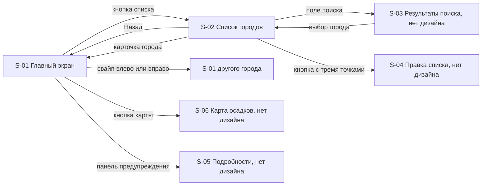

# 05. Экраны и навигация

Скриншоты в этом документе сделаны с макетов, это не снимки приложения. Для каждого экрана дан перечень элементов и действий. Тип действия из гида по макетам: **нажать**, **листать**, **смотреть**.

## Перечень экранов

| ID | Экран | Дизайн | Требования |
| --- | --- | --- | --- |
| S-00 | Сплэш «Восход» при запуске | есть (iPhone, Android) | FR-23 |
| S-01 | Главный экран города | есть (день, ночь, гроза) | FR-01…FR-08, FR-13, FR-17, FR-21 |
| S-02 | Список городов | есть | FR-09, FR-10, FR-12, FR-20 |
| S-03 | Результаты поиска | нет | FR-10, FR-11 |
| S-04 | Режим правки списка | нет | FR-14 |
| S-05 | Подробности предупреждения | нет | FR-17 |
| S-06 | Карта осадков | нет | FR-19 |
| S-07 | Системный запрос геолокации и пояснение | нет | FR-16 |
| S-08 | Состояния: загрузка, ошибка, пустой список | нет | FR-18 |

День и ночь, дождь и гроза — это не разные экраны, а состояния одного экрана S-01: меняются тема и небо.

## Навигация

Точка входа: S-01 для первого города (текущее местоположение, если доступно, иначе первый в списке). Если список пуст, поведение не определено (S-08). При холодном запуске перед S-01 играет сплэш S-00 и сам переходит в S-01.

## S-00. Сплэш «Восход»

Нативная заставка: ночное небо, линия горизонта и половинка солнца. Дальше та же картинка оживает: солнце (ночью луна) поднимается, вдоль горизонта разливается свет, внизу по одному слову всплывает название One More Weather App. Слова One, More, App белые, Weather цвета солнца и прилетает с пружинкой. Затем камера поднимает взгляд: горизонт и название уходят вниз, небо светлеет от точки восхода к краям, солнце улетает в правый верхний угол. Температура вылетает из точки восхода навстречу и садится на своё место, отсчитывая градусы, за ней появляются город и панели. Действий нет, около 2.6 с. При «Уменьшении движения» кадр с названием гаснет без движения.

## S-01. Главный экран города

 

Экран прокручивается вниз. Футер с тремя кнопками закреплён над контентом.

| Элемент | Что показывает | Действие | Данные | Требование |
| --- | --- | --- | --- | --- |
| Небо (фон) | состояние погоды города, время суток | смотреть | состояние, тема дня | FR-02, FR-03 |
| Название города | город, по которому открыт экран | смотреть | название | FR-01 |
| Температура | текущая температура крупно, отсчитывается от нуля при открытии | смотреть | температура | FR-01, FR-21 |
| Состояние | «Небольшой дождь» и подобное | смотреть | текст состояния | FR-01 |
| Максимум и минимум | «Макс.: 9°, мин.: 4°» | смотреть | макс., мин. дня | FR-01 |
| Панель предупреждения (при наличии) | значок, «Штормовое предупреждение», суть, детали | нажать | предупреждение | FR-17 |
| Сводка | одна-две фразы о ближайших осадках | смотреть | генерируется (BR-15) | FR-05 |
| Лента часов | «Сейчас» и часы вперёд, иконки, шанс осадков, температура | листать вбок | почасовой прогноз | FR-04 |
| Прогноз на 10 дней | строки по дням со шкалой температур | смотреть, листать экран | дневной прогноз | FR-06 |
| Плитки показателей | пары плиток: название, значение, пояснение | смотреть | показатели | FR-07, FR-08 |
| Кнопка карты (футер, слева) | открывает карту осадков | нажать | нет | FR-19 |
| Точки городов (футер, по центру) | какой по счёту город открыт; первая точка стрелка для местоположения | листать (свайп по экрану) | список городов | FR-13 |
| Кнопка списка (футер, справа) | открывает список городов | нажать | нет | FR-09 |

Состояния и варианты, нарисованные в макетах: день и дождь, ночь и ясно, ночь и гроза с предупреждением. Набор плиток в макетах разный: «Ощущается как» и «Ветер» (день), «Восход» и «Влажность» (ночь), «Осадки» и «Ветер» (гроза). Правило выбора плиток не определено (Q-07).

## S-02. Список городов

| Элемент | Что показывает | Действие | Данные | Требование |
| --- | --- | --- | --- | --- |
| Кнопка «Назад» | возврат на главный экран | нажать | нет | FR-12 |
| Кнопка с тремя точками | правка списка: удаление и порядок (допущение) | нажать | нет | FR-14 |
| Заголовок «Города» | название экрана | смотреть | нет | FR-09 |
| Поле поиска | «Найти город или аэропорт» | нажать, вводить текст | справочник городов | FR-10 |
| Карточка города | название, подпись, температура, состояние, макс. и мин.; фон — небо города | нажать | погода города | FR-09, FR-12 |
| Подпись карточки | «Моё местоположение · 14:05» у текущего местоположения, у остальных только локальное время | смотреть | часовой пояс города | FR-16, FR-20 |
| Прокрутка | остальные города | листать | нет | FR-09 |

В макете каждая карточка живёт в своей теме: в Новосибирске и Владивостоке карточки ночные, пока в Москве день.

## Версия для Android

Экраны такие же, различаются матовое стекло и системный шрифт Roboto.

 

## Подсказки по макету

Гид по макетам подписывает каждый элемент и показывает его тип (нажать, листать, смотреть). Это единственный источник предположений о свайпе между городами, кнопке карты и кнопке правки списка.

## Пробелы в дизайне

Требуют решения до начала разработки соответствующих частей.

| № | Чего нет | Влияет на | Вопрос |
| --- | --- | --- | --- |
| 1 | Экран результатов поиска и добавления города | FR-10, FR-11 | Q-08 |
| 2 | Режим правки списка | FR-14 | Q-10 |
| 3 | Подробности предупреждения | FR-17 | Q-16 |
| 4 | Карта осадков | FR-19 | Q-11 |
| 5 | Состояния загрузки, ошибки, пустого списка, отказа от геолокации | FR-18 | Q-04 |
| 6 | Небо для снега | FR-02 | Q-12 |
| 7 | Единый формат максимума и минимума: в шапке «Макс.: 9°, мин.: 4°», в карточке «Макс. 9° · мин. 4°» | FR-01, FR-09 | Q-13 |
| 8 | Правило выбора плиток | FR-07 | Q-07 |
