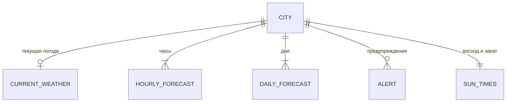

# 06. Бизнес-правила и данные

## Бизнес-правила

Источник: дизайн-система и макеты. Где правило выведено аналитиком, это отмечено.

| ID | Правило | Где применяется |
| --- | --- | --- |
| BR-01 | Тема экрана определяется локальным временем города: ночь наступает на закате этого города и заканчивается на восходе. Системная тема телефона не учитывается. Каждая карточка в списке и каждый главный экран получают тему своего города. | FR-03, FR-09 |
| BR-02 | Первой в списке городов и первой страницей главного экрана стоит текущее местоположение, если пользователь разрешил его определение. Оно помечено «Моё местоположение», его точка в футере рисуется стрелкой. | FR-16, FR-13 |
| BR-03 | Температура показывается целым числом в градусах Цельсия. Отрицательные значения пишутся с типографским минусом («−3°»), знак градуса стоит сразу за числом без пробела. Правило округления в дизайне не задано. Предположение: математическое округление. | FR-01, FR-04, FR-06, FR-09 |
| BR-04 | Время в 24-часовом формате по местному времени города. Часы в ленте двузначные («00», «15»). Первый пункт ленты называется «Сейчас». | FR-04, FR-20 |
| BR-05 | Шанс осадков показывается только если он больше нуля. В ленте часов и в списке дней он стоит под иконкой в процентах. | FR-04, FR-06 |
| BR-06 | Шкала температур в прогнозе на 10 дней общая для всех показанных дней: она идёт от самой низкой минимальной до самой высокой максимальной температуры. Полоска дня занимает отрезок от его минимума до максимума. Цвет идёт от холодного к тёплому в масштабе всей шкалы. Точка «сейчас» есть только у сегодняшнего дня. | FR-06 |
| BR-07 | Иконка ясной погоды ночью — луна, днём — солнце. Всего иконок семь: ясно (солнце), ясно ночью (луна), переменная облачность, облачно, дождь, гроза, снег. | FR-04, FR-06 |
| BR-08 | Небо выбирается по состоянию текущей погоды города из пяти вариантов: ясно, переменная облачность, облачно, дождь, гроза. При ясной и переменной погоде в углу светит солнце днём или луна ночью. Для снега варианта нет (Q-12). | FR-02 |
| BR-09 | Предупреждение всегда сопровождается значком и словами в заголовке. Цвет предупреждения сам по себе ничего не обозначает. | FR-17 |
| BR-10 | Тексты безличные, без советов, без эмодзи: пишется факт («Дождь закончится около 17:00»), а не рекомендация («Возьмите зонт»). | FR-05, FR-08, FR-17 |
| BR-11 | Материал стекла выбирается по наличию Liquid Glass: если он доступен, используется он, иначе матовое стекло с тёмной тонировкой. Решение зависит от возможности системы, а не от платформы. | NFR-03 |
| BR-12 | При включённом «Уменьшении движения» дождь, дрейф облаков и отсчёт температуры выключены. | FR-21, NFR-11 |
| BR-13 | Дни недели: первый день называется «Сегодня», дальше идут сокращения «Пн», «Вт», «Ср», «Чт», «Пт», «Сб», «Вс». | FR-06 |
| BR-14 | Единицы: градусы Цельсия, метры в секунду, миллиметры, проценты. **Предположение.** Переключателя единиц нет (Q-03). | все |
| BR-15 | Сводка над лентой часов: одно-два предложения о ближайших осадках и ночной температуре. Правило формирования не определено (Q-14). | FR-05 |
| BR-16 | Один город добавляется в список один раз. **Предположение**, выведено аналитиком. | FR-11 |

### Форматы вывода

| Что | Формат | Пример |
| --- | --- | --- |
| Температура | целое число, градус без пробела, типографский минус | `8°`, `−3°` |
| Максимум и минимум в шапке | `Макс.: 9°, мин.: 4°` | см. Q-13 |
| Максимум и минимум в карточке | `Макс. 9° · мин. 4°` | см. Q-13 |
| Время суток | `ч:мм`, 24 часа | `8:52`, `14:05` |
| Час в ленте | две цифры | `00`, `15` |
| Шанс осадков | целое число процентов | `60%` |
| Ветер | число и единица | `6 м/с` |
| Осадки | число и единица | `18 мм` |
| Влажность | число и процент | `86%` |

Максимум и минимум в шапке и в карточке записаны по-разному. Нужно выбрать один формат (Q-13).

## Состав данных

Данные нужны на каждый показанный элемент. Откуда их брать, не решено (Q-02): таблицы описывают, что нужно экрану, а не что отдаёт конкретный поставщик.

### Город (CITY)

Хранится на устройстве (FR-15).

| Поле | Тип | Зачем | Источник |
| --- | --- | --- | --- |
| идентификатор | строка | различать города | справочник |
| название | строка | заголовок, карточка | справочник |
| страна или регион | строка | различать одноимённые города в поиске. **Предположение**, в дизайне не показано | справочник |
| координаты | широта, долгота | запрос погоды | справочник |
| часовой пояс | идентификатор | локальное время и тема | справочник |
| признак текущего местоположения | да или нет | пометка «Моё местоположение» | приложение |
| порядок | число | порядок в списке и страницах | приложение |

### Текущая погода (CURRENT_WEATHER)

| Поле | Единица | Где показывается |
| --- | --- | --- |
| температура | °C | шапка, карточка города, точка на шкале дня |
| код состояния | из набора условий | небо, иконка, текст состояния |
| текст состояния | строка | шапка («Небольшой дождь»), карточка |
| ощущаемая температура | °C | плитка «Ощущается как» |
| скорость ветра, порывы | м/с | плитка «Ветер» |
| направление ветра | румб | пояснение плитки («Северо-западный») |
| влажность | % | плитка «Влажность» |
| точка росы | °C | пояснение плитки |
| осадки за последние часы | мм | плитка «Осадки» |
| время получения | момент времени | проверка свежести (NFR-07) |

### Прогноз по часам (HOURLY_FORECAST), 24 записи

| Поле | Единица | Где показывается |
| --- | --- | --- |
| час | локальное время | лента часов |
| код состояния | из набора условий | иконка |
| шанс осадков | % | под иконкой, если больше нуля |
| температура | °C | лента часов |

### Прогноз по дням (DAILY_FORECAST), 10 записей

| Поле | Единица | Где показывается |
| --- | --- | --- |
| дата | день | название дня («Сегодня», «Вт») |
| код состояния | из набора условий | иконка |
| шанс осадков | % | под иконкой, если больше нуля |
| минимум, максимум | °C | значения и шкала |

### Восход и закат (SUN_TIMES)

| Поле | Зачем |
| --- | --- |
| время восхода и заката на сегодня | тема день или ночь, плитка «Восход» |
| время заката следующего дня | пояснение плитки («Закат в 16:29») |

### Предупреждение (ALERT)

| Поле | Где показывается |
| --- | --- |
| заголовок типа («Штормовое предупреждение») | верхняя строка панели |
| суть («Гроза и ливень до 01:00») | основной текст панели |
| подробности | вторичный текст и экран подробностей |
| время окончания | для скрытия устаревших предупреждений |

## Набор условий погоды

В дизайне три слоя классификации: небо, иконка и текст. Они совпадают не полностью, поэтому нужна таблица соответствия, когда будет выбран поставщик.

| Состояние | Небо | Иконка | Текст |
| --- | --- | --- | --- |
| Ясно | ясно, солнце днём или луна ночью | солнце или луна | «Ясно» |
| Малооблачно, переменная облачность | переменная облачность | переменная облачность | «Малооблачно», «Переменная облачность» |
| Облачно | облачно | облако | «Облачно» |
| Дождь | дождь | дождь | «Небольшой дождь» и другие оттенки |
| Гроза | гроза | гроза | «Гроза» |
| Снег | нет варианта | снег | не показан в макетах |

Тексты состояний в макетах точнее иконок («Небольшой дождь» против одной иконки дождя), значит, текст приходит от поставщика или собирается из кода и интенсивности. Это решается вместе с выбором поставщика.

## Хранение и обновление

- На устройстве хранятся список городов с порядком и, если принято решение показывать данные без сети, последние полученные данные с временем получения (Q-04).
- Данные запрашиваются при запуске, при возврате в приложение, если они старше 30 минут, и по запросу пользователя (FR-22).
- Погода запрашивается только для городов из списка и для текущего местоположения, если оно включено.
