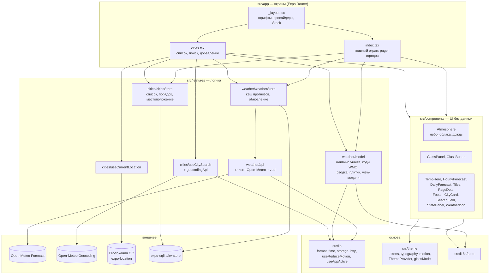
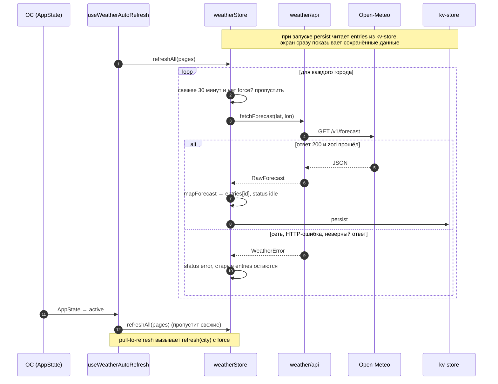
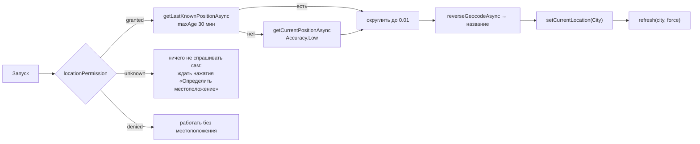
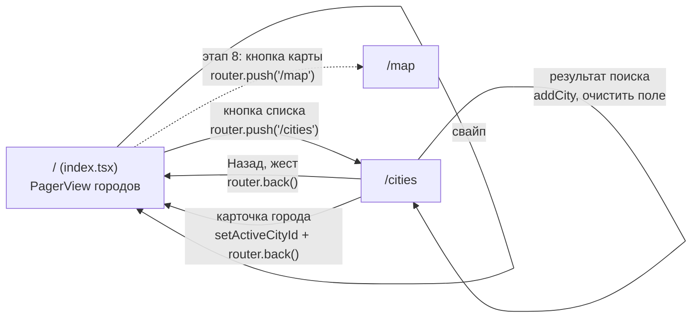
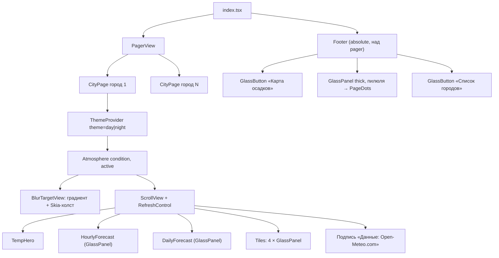

# 01. Архитектура

Как устроено приложение: слои, модули, поток данных, навигация, структура папок. Решения здесь окончательные для первой версии: если задача в [05](05-implementation-plan.md) требует другого, сначала поменяй этот документ.

## Коротко

- Expo SDK 58, React Native 0.88, TypeScript strict, Expo Router. Только телефоны, только портрет.
- Погода и поиск городов: Open-Meteo, без ключа и без своего сервера ([02](02-data-sources.md)).
- Состояние: два стора `zustand`. Список городов и последние полученные данные сохраняются на устройстве через `expo-sqlite/kv-store`.
- Всё, что считает и форматирует, сделано чистыми функциями без React (`src/lib`, `src/features/*/model`). Их легко тестировать.
- Компоненты в `src/components` ничего не знают о сторах и API: получают готовые данные пропсами. Экраны в `src/app` связывают сторы с компонентами.

## Слои и зависимости



### Правила зависимостей

| Модуль | Может импортировать | Не может |
| --- | --- | --- |
| `src/app/*` | всё | — |
| `src/components/*` | `src/theme`, `src/i18n`, `src/lib`, другие компоненты, типы из `features/*/types.ts` | сторы, API, `expo-location` |
| `src/features/weather/model/*` | `src/lib`, `src/i18n`, типы | React, сторы, `fetch` |
| `src/features/*/api.ts` | `src/lib/http.ts`, `zod` | React, сторы |
| `src/features/*/…Store.ts` | API, model, `src/lib/storage.ts` | компоненты |
| `src/lib/*` | только сторонние утилиты | всё из `src/` кроме `src/lib` |

Если компоненту нужны данные, которых нет в пропсах, добавь их в view-модель, а не подключай стор в компоненте.

## Модули

### Экраны

| Файл | Что делает |
| --- | --- |
| `src/app/_layout.tsx` | Держит сплэш, пока грузятся шрифты. Оборачивает приложение в `SafeAreaProvider`. Ставит `<StatusBar style="light" />`. Объявляет `Stack` с `headerShown: false` и `contentStyle` цвета `sky-bottom`. Запускает `useWeatherAutoRefresh()`. |
| `src/app/index.tsx` | Главный экран. Берёт список страниц из `citiesStore` (местоположение + сохранённые), рисует `PagerView`, в каждой странице `CityPage`. Футер лежит поверх pager и не листается. Пустой список даёт стартовое состояние ([03](03-domain-and-rules.md#состояния-экрана)). |
| `src/app/cities.tsx` | Список городов: шапка (назад, правка), заголовок, поле поиска. Пустое поле показывает карточки городов, непустое показывает результаты поиска. Нажатие на карточку делает город активным и возвращает назад. |
| `src/app/map.tsx` | Этап 8, карта осадков. До этого кнопка карты скрыта или неактивна ([05](05-implementation-plan.md#этап-8-после-первой-версии)). |

`CityPage` (`src/features/weather/CityPage.tsx`) — экранный блок одного города: `ThemeProvider` с темой города, `Atmosphere`, `ScrollView` с `RefreshControl`, внутри `TempHero`, `HourlyForecast`, `DailyForecast`, `Tiles`, подпись источника. Он связывает `weatherStore` с компонентами, поэтому живёт в `features`, а не в `components`.

### Сторы

`citiesStore` (сохраняется):

```ts
interface CitiesState {
  currentLocation: City | null; // город по геолокации, всегда первая страница
  saved: City[];                // добавленные пользователем, в порядке списка
  locationPermission: 'unknown' | 'granted' | 'denied';
  addCity(city: City): 'added' | 'duplicate';
  removeCity(id: string): void;            // этап 8
  moveCity(id: string, dir: -1 | 1): void; // этап 8
  setCurrentLocation(city: City | null): void;
  setLocationPermission(p: CitiesState['locationPermission']): void;
}
// Производное значение, а не поле стора:
const selectPages = (s: CitiesState): City[] =>
  s.currentLocation ? [s.currentLocation, ...s.saved] : s.saved;
```

`weatherStore` (сохраняются только `entries`):

```ts
interface WeatherState {
  entries: Record<string, Forecast>;               // ключ — City.id; Forecast.fetchedAt = Date.now() при получении
  status: Record<string, 'idle' | 'loading' | 'error'>;
  error: Record<string, WeatherError | undefined>;
  refresh(city: City, opts?: { force?: boolean }): Promise<void>;
  refreshAll(cities: City[], opts?: { force?: boolean }): Promise<void>;
}
```

`uiStore` (не сохраняется): `activeCityId: string | null`, `setActiveCityId(id)`. Через него экран городов говорит главному, какую страницу открыть.

### Логика погоды (`src/features/weather/model`)

Чистые функции, у каждой свой тест ([06](06-testing.md)):

| Файл | Функция | Что делает |
| --- | --- | --- |
| `mapForecast.ts` | `mapForecast(raw, fetchedAt): Forecast` | ответ API → доменная модель |
| `conditions.ts` | `skyFor(code)`, `iconFor(code, isDay)`, `labelFor(code)`, `isPrecipitation(code)` | таблица кодов WMO |
| `summary.ts` | `buildSummary(forecast, now): string` | фраза над лентой часов |
| `tiles.ts` | `buildTiles(forecast, now): TileVM[]` | 4 плитки и их пояснения |
| `viewModels.ts` | `buildMainVM(city, forecast, now)`, `buildCityCardVM(city, forecast, now)` | всё, что нужно экрану, в готовом виде |

## Поток данных

### Обновление погоды



Правила:

- Свежесть: `Date.now() - forecast.fetchedAt < 30 * 60 * 1000` (NFR-07). Свежие данные не перезапрашиваются, кроме `force`.
- Повторный вызов `refresh` для города, который уже грузится, возвращает тот же промис (держи `Map<cityId, Promise>` вне стора).
- Ошибка не стирает старые данные. Экран показывает их с пометкой времени (NFR-08).
- Запросы для нескольких городов идут параллельно, но не больше 4 одновременно. При 20 городах это укладывается в лимиты Open-Meteo ([02](02-data-sources.md#лимиты)).
- Новый город (после добавления или определения местоположения) обновляется сразу, с `force: true`.

### Текущее местоположение



Разрешение запрашивается только по действию пользователя: кнопка в стартовом состоянии главного экрана или пункт в списке городов (NFR-14).

## Навигация



- `Stack` без заголовков: шапки рисуют сами экраны (круглые стеклянные кнопки).
- Главный экран при изменении `activeCityId` вызывает `pagerRef.current?.setPage(index)`, а `onPageSelected` записывает индекс в локальное состояние для `PageDots`.
- Системный жест «назад» работает на обеих платформах. В `app.json` стоит `predictiveBackGestureEnabled: false`, не трогай это.

## Дерево главного экрана



- У каждой страницы своё небо и своя тема: при свайпе небо уезжает вместе с городом.
- `active` у `Atmosphere` истинно только у видимой страницы и только когда приложение активно (`useAppActive`). Остальные страницы рисуют неподвижный кадр (NFR-06).
- Футер берёт тему активной страницы.
- `ScrollView` — сосед `BlurTargetView`, а не потомок. На Android только так `BlurView` в панелях размывает небо ([04](04-ui-spec.md#glasspanel)).

## Структура папок

```
src/
  app/
    _layout.tsx
    index.tsx
    cities.tsx
  components/
    atmosphere/      Atmosphere.tsx, SkyEffects.tsx (+ .web.tsx), SkyCanvas.tsx, Glow.tsx, Clouds.tsx, Rain.tsx, BlurTargetContext.ts
    glass/           GlassPanel.tsx, GlassButton.tsx, PressableScale.tsx, useReveal.ts
    Pager.tsx  Pager.web.tsx          страницы городов: PagerView; в вебе ScrollView (только превью)
    icons/           WeatherIcon.tsx, UiIcon.tsx (назад, ещё, карта, список, поиск)
    TempHero.tsx  HourlyForecast.tsx  DailyForecast.tsx  TempBar.tsx  Tiles.tsx
    PageDots.tsx  Footer.tsx  CityCard.tsx  SearchField.tsx  StatePanel.tsx
    PanelHeader.tsx  Reveal.tsx
  features/
    weather/
      api.ts  schema.ts  types.ts  weatherStore.ts  useWeatherAutoRefresh.ts  CityPage.tsx
      model/  mapForecast.ts  conditions.ts  summary.ts  tiles.ts  viewModels.ts
      __tests__/  __fixtures__/
    cities/
      types.ts  citiesStore.ts  uiStore.ts  geocodingApi.ts  useCitySearch.ts  useCurrentLocation.ts
      __tests__/
  lib/
    format.ts  time.ts  http.ts  storage.ts  useReduceMotion.ts  useAppActive.ts  useDebouncedValue.ts
    __tests__/
  theme/
    tokens.ts  typography.ts  motion.ts  ThemeProvider.tsx  glassMode.ts  fonts.ts
  i18n/
    ru.ts
  mocks/
    mainScreens.ts  citiesList.ts   (данные макетов для этапов 2–3)
```

Алиас `@/*` → `./src/*` в `tsconfig.json`. Импорты пиши через него: `import { tokens } from '@/theme/tokens'`.

## Зависимости

Ставятся только `npx expo install` (они же в [05](05-implementation-plan.md#этап-0-основа)).

| Пакет | Зачем |
| --- | --- |
| `expo-router`, `react-native-safe-area-context`, `react-native-screens`, `expo-linking`, `expo-constants`, `expo-status-bar` | навигация, safe area |
| `expo-dev-client` | development build |
| `react-native-reanimated`, `react-native-worklets` | все анимации |
| `expo-glass-effect` | Liquid Glass на iOS 26+ |
| `expo-blur` | матовое стекло без Liquid Glass |
| `expo-linear-gradient` | градиент неба, шкала температур |
| `@shopify/react-native-skia` | свечение, облака, дождь |
| `react-native-svg` | иконки погоды и интерфейса |
| `expo-font`, `@expo-google-fonts/bricolage-grotesque`, `expo-splash-screen` | шрифт цифр |
| `react-native-pager-view` | свайп между городами |
| `expo-sqlite` | `expo-sqlite/kv-store` для `persist` |
| `zustand` | сторы |
| `zod` | проверка ответов API |
| `expo-location` | текущее местоположение |
| `jest-expo`, `jest`, `@types/jest`, `@testing-library/react-native` (dev) | тесты |
| `react-native-webview` | только этап 8, карта осадков |

`expo-symbols` не нужен: значки интерфейса рисуются теми же SVG, что в макетах, одинаково на обеих платформах ([04](04-ui-spec.md#значки-интерфейса)). `react-native-web` остаётся в `package.json`, но веб не поддерживается: Skia на вебе требует отдельной настройки, а дизайн только для телефонов.
