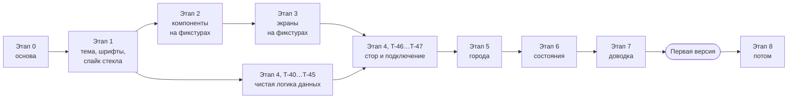

# 05. План реализации

## Упрощение 2026-10-29

Проект учебный, и владелец упростил его, чтобы код было легче читать. Что убрано:

- **Стекло.** Нет Liquid Glass (`expo-glass-effect`), матового стекла (`expo-blur`), выбора материала (`glassMode`, `GlassModeProvider`, «Уменьшение прозрачности»), цепочки цели размытия (`BlurTargetView`, `BlurTargetContext`, `onBlurTarget`) и теней панелей. Вместо `GlassPanel` и `GlassButton` — `Panel` (заливка `panel` и кромка `panelEdge`) и `RoundButton`; появление вынесено из панели в `Reveal`; `useReveal` слит с `Reveal`. Токены `glass*` → `panel`, `panelStrong`, `panelEdge`, `cloud`; кривая `ease.glass` → `ease.out`.
- **Веб-превью.** Нет `react-native-web`, `react-dom`, скрипта `web`, двойников `*.web.*` и прослоек ради них (`Pager`, `SkyEffects`): `PagerView` и `SkyCanvas` подключены напрямую.
- **`uiStore`.** Экран городов возвращается на главный через `router.dismissTo` с параметром `city`.
- **`useMinuteTick`.** «Сейчас» на главном экране — позднейшее из момента открытия страницы и времени получения прогноза; на экране городов — момент открытия. Раз в минуту ничего не пересчитывается.
- **Анимации иконок упрощены.** У каждой иконки одно движение вместо девяти циклов.

Каскад появления и сплэш «Восход» оставлены. Задачи ниже, где упоминаются стекло, веб, `uiStore` и `useMinuteTick` (T-12, T-23, T-25 и другие), описывают, как было сделано тогда.

## Статус на 2026-10-28

Главный экран реализован на настоящих данных Open-Meteo. Проверено: `tsc`, `expo lint`, `jest` (91 тест), `expo-doctor`, сборка бандлов Metro под iOS и Android (`npx expo export`). **На устройстве и симуляторе не запускалось**: на машине разработки нет CocoaPods и Android SDK. Вместо этого приложение собрано как веб-превью и проверено в Chrome: раскладка, шрифты, небо на Skia, дождь, ночная тема, пейджер, футер, состояния ошибки и устаревших данных. В вебе работает матовое стекло, Liquid Glass, нативное размытие Android и производительность по-прежнему не проверены.

| Задачи | Статус | Примечание |
| --- | --- | --- |
| T-01…T-03, T-05, T-06 | сделано | зависимости из T-03 стоят, ESLint и Jest настроены |
| T-02 | сделано | `index.ts` и `App.tsx` удалены, `main` = `expo-router/entry` |
| T-04 | сделано | `blockedPermissions` для `ACCESS_FINE_LOCATION` пробовали 2026-10-30 и убрали: на эмуляторе с одним грубым разрешением координат нет. В плагине `expo-location` выключены ключи «всегда», точной геопозиции и движения, по умолчанию предлагается приблизительное местоположение ([02](02-data-sources.md#местоположение-expo-location)) |
| T-07 | сделано | iOS: `npx expo run:ios`, симулятор iPhone 18 Pro (iOS 27), Liquid Glass работает. Android: `npx expo run:android` (debug и `--variant release`), эмулятор Pixel 7 Pro API 35; первая сборка 23 минуты, Gradle сам докачал SDK 37, NDK и CMake |
| T-10, T-11, T-13 | сделано | |
| T-12 спайк стекла | сделано частично | Решение: **Skia-холст лежит вне `BlurTargetView`**. Внутри цели он заставлял каждый `BlurView` на Android пересчитывать размытие на каждом кадре анимации неба: 2.5 с на кадр в debug, касания не обрабатывались. На Android стекло размывает только градиент, дождь и облака за панелями не видны (допускается дизайном) |
| T-20, T-21 | сделано | данные макетов в `src/mocks/mainScreens.ts` (используются тестами) |
| T-22…T-28 | сделано | `Atmosphere`, `GlassPanel`, `GlassButton`, `WeatherIcon`, `TempHero`, `HourlyForecast`, `DailyForecast`, `Tiles`, `PageDots`, `Footer` |
| T-29 | сделано | `CityCard`, `SearchField`, `StatePanel`; данные макета карточек в `src/mocks/citiesList.ts` |
| T-30 | сделано | сразу на данных, не на заглушках |
| T-31 | сделано | сразу на данных (T-52). Кнопка «Изменить список» скрыта до этапа 8, на её месте пустое место 44 |
| T-32 сверка с макетами | не сделано | нужны устройства |
| T-40…T-47 | сделано | |
| T-50 | сделано | `SEED_CITIES` убран: новая установка начинает с пустого списка (сохранённый список на уже установленных копиях остаётся) |
| T-51, T-52 | сделано | поиск Open-Meteo Geocoding, добавление, «Уже в списке», выбор города. Проверено в веб-превью (Chrome): «Каз» → Казань добавляется с погодой, «ывапр» → «Ничего не нашлось». На симуляторе и устройстве не проверено |
| T-53 | сделано | 2026-10-30. `src/features/cities/useCurrentLocation.ts`: `requestAndLocate()` по кнопке, `refreshLocation()` при запуске и возврате в приложение. Кнопка «Определить местоположение» в стартовом состоянии главного экрана и пилюлей над карточками на экране городов. `weatherStore.refresh` при смене координат во время запроса запрашивает заново. Проверено на симуляторе iPhone 18 Pro (доступ выдан через `simctl`, нажатие кнопки не проверялось: нечем нажимать): первой страницей встаёт город по координатам с названием от геокодера ОС, в точках стрелка; переезд с возвратом в приложение меняет название и погоду; отзыв доступа убирает страницу. Android: первая сборка с одним `ACCESS_COARSE_LOCATION` не определяла место на эмуляторе, см. T-04; запустить сначала не удалось: эмулятор Pixel 3a (2 ГБ RAM) ушёл в своп, система и приложение висели с ANR на сплэше (T-72). Нажатие кнопки и системный диалог доступа на Android не проверены |
| T-54 | сделано частично | страницы по `selectPages`, переход к городу через подписку на `uiStore`, текущая страница хранится по `id`. Не проверено на устройстве |
| T-60 | сделано частично | загрузка, ошибка без данных, ошибка со старыми данными, пустой список городов, поиск (идёт, ничего не нашлось, ошибка), геолокация (идёт определение, не удалось, доступ запрещён) |
| T-61 | сделано | |
| T-72 производительность | начато | Android, эмулятор (3 ГБ RAM, QHD+, своп): release до исправления 89 мс на кадр; после исправления замер не удался, эмулятор деградировал, после перезапуска adb не подключился. Остальные затраты по debug-замерам: анимации иконок около 300 мс на кадр, тени `boxShadow` с размытием 40. Нужен замер на реальном Android-устройстве. 2026-10-29, сплэш (T-74): монтаж главного экрана занимает поток отрисовки на 1–2.6 с на эмуляторе Pixel 3a API 34 (до 5 с, когда эмулятор под нагрузкой); следующий шаг — облегчить первый рендер (монтировать сначала видимое: шапку, ленту часов, небо) |
| T-74 сплэш «Восход» | сделано | 2026-10-29. Проверено: `tsc`, `expo lint`, `jest` (132 теста); симулятор iPhone 18 Pro (iOS 27), запись холодного старта по кадрам: release-сборка без городов, debug- и release-сборки с Москвой (вылет температуры, затем панели); эмулятор Pixel 3a API 34, release без городов и с Москвой. Остаётся неподвижная пауза в собранном кадре на время монтажа главного экрана: около 1.4 с на iOS, 2.6–5 с на эмуляторе Android (T-72); под нагрузкой эмулятора раскрытие неба опережает отрисовку экрана и полёт температуры не виден. На устройствах не запускалось |
| T-80 (часть) | сделано частично | 2026-10-30. Удаление городов: кнопка «Изменить список» в шапке экрана городов включает правку (значок меняется на «Готово»), у каждого сохранённого города справа кнопка удаления, без подтверждения. Местоположение не удаляется. Правка закрывается сама, когда удалять нечего. Порядок городов не меняется, кнопок «вверх» и «вниз» нет. Удаление чистит и прогноз города (`weatherStore.forget`) |
| Обзор дефектов 2026-10-30 | сделано | Исправлено: кнопка удаления у карточки с длинной подписью (`flexShrink`); «сейчас» в ленте и сводке считается от настоящего времени (`useNowMs`: момент монтирования и возврата в приложение, `atNow` в `buildMainVM`), а не от снимка `current.time`; подложка `StatusBarScrim` под строкой статуса на главном экране и экране городов; русское название места на Android (поиск Open-Meteo по названию ОС, если оно латиницей); страны (`PCL*`) убраны из поиска городов; страница местоположения остаётся первой, пока пользователь сам не листал; неразрывные пробелы в «до 3°», «2,3 мм», «порывы до 7 м/с». Не исправлено: время на карточках не тикает (решение владельца 2026-10-29), производительность Android (T-72), «разрешить один раз» на iOS (A-10) |
| Задержка точек футера (iOS) | сделано | 2026-10-30. Точка менялась только в `onPageSelected` (после анимации пейджера), а потом перерисовывались все страницы целиком (замер в debug: первая перерисовка через 556 мс, до 2.9 с коммитов). Теперь: точка и футер меняются сразу при нажатии, `CityPage` в `memo`, смена `active` у страниц идёт через `useDeferredValue` (первая перерисовка через 46–91 мс). Замер в debug-сборке на симуляторе, на устройстве и в release не мерили |
| T-70, T-71, T-73, остальное в этапе 8 | не сделано | |

### Отличия от плана, появившиеся при реализации

- `weatherStore.entries` хранит `Forecast` напрямую (`fetchedAt` внутри `Forecast`), без обёртки `WeatherEntry`.
- Имена шрифтов (`src/theme/fonts.ts`) и файлы шрифтов (`src/theme/fontAssets.ts`) разнесены: иначе любой тест, который импортирует типографику, тянет `expo-font`.
- На Liquid Glass `PressableScale` не сжимает панель: это делает система (`isInteractive`). Сжатие 0.97 только у матового стекла.
- У `GlassPanel` в режиме Liquid Glass `opacity` не анимируется: стекло включается переходом `none → regular`, содержимое проявляется отдельно. Таймер `shown` в `useReveal` работает только в этом режиме.
- Футер лежит вне `Atmosphere`, поэтому на Android у него нет цели для `BlurView`: остаются заливка и кромка. Если это заметно, передавать в футер `ref` цели активной страницы.
- `useReduceMotion` читает контекст (`ReduceMotionProvider` в `_layout`): одна подписка на всё приложение вместо сотни.
- Анимированные значения Reanimated в обработчиках нажатия меняются через `.set()`, а не присваиванием `.value`: иначе правила React Compiler в `eslint-config-expo` дают ошибку.
- `tempHero` с `includeFontPadding: false`: иначе Android добавляет над цифрами лишний воздух.
- `tempHero` без `lineHeight`: строка 108 при шрифте 120 в iOS обрезала верх цифры и сдвигала её на название города. Высота строки естественная, воздух снимают отступы `marginTop: -8`, `marginBottom: -20` в `TempHero`.
- `formatMm`: целое число без десятичной части (`9`, не `9,0`), как в макете «Ещё 9 мм».
- Часы в ленте рисуются после замера ширины панели (`onLayout`), до него занято место под ленту.
- **Контекст React не проходит внутрь `<Canvas>` Skia** (у него свой рендерер): `Glow`, `Clouds` и `Rain` получают цвета пропсами от `SkyCanvas`. Это нашлось только при запуске в вебе.
- Футер лежит вне неба, поэтому `MainScreen` держит цель размытия активной страницы (`Atmosphere.onBlurTarget`) и отдаёт её футеру через `BlurTargetContext`. Без этого текст строк просвечивал сквозь футер. `BlurView` в `GlassPanel` рисуется на iOS и в вебе всегда, на Android только при наличии цели.
- В Bricolage Grotesque нет кириллицы: названия городов набраны системным шрифтом (так и в макетах). В вебе для этого у `fontFamily` задан запасной список (`src/theme/fonts.ts`), иначе браузер берёт засечный.
- Пейджер вынесен в `src/components/Pager.tsx` (нативный `PagerView`) и `Pager.web.tsx` (`ScrollView`). Слой Skia: `SkyEffects.tsx` и `SkyEffects.web.tsx` (ленивая загрузка CanvasKit). Хранилище: `storage.web.ts` на `localStorage`. Всё это нужно только веб-превью.
- Обёртки внутри `GlassPanel` и `PressableScale` растягиваются через `flexGrow: 1`, а не `flex: 1`. С `flex: 1` (базовая высота 0) панель вне `ScrollView` схлопывалась в ноль: на iOS панель пустого списка и загрузки была невидима. Нашлось 2026-10-29 при проверке сплэша; в вебе ошибки не было.
- Кнопки в `StatePanel` — не стекло (стекло на стекло не кладём), размер задаёт обёртка.
- `searchCities` возвращает `SearchResult { city, sub }`, а не `City[]`: подпись «Аэропорт · регион, страна» зависит от `feature_code`, которого в `City` нет.
- `useCitySearch`, пока ответ на новый текст не пришёл, отдаёт статус `loading` с прошлыми результатами: список не мигает при наборе. Пока в поле меньше 2 символов (`idle`), экран показывает карточки, а не пустые результаты.
- «Ничего не нашлось», «Поиск недоступен» и «Поиск…» стоят в той же стеклянной панели, что и результаты, а не отдельной строкой на небе.
- `buildCityCardVM(city, forecast, now, failed)`: без прогноза подпись только «Моё местоположение» или пустая (сдвига часового пояса ещё нет), `a11y` = «{название}, загрузка…». Максимум и минимум карточки считаются той же функцией, что и шапка главного экрана.
- Тест экрана городов (`src/features/cities/__tests__/CitiesScreen.test.tsx`) подменяет `useDebouncedValue` на мгновенный: фейковые таймеры Jest ломают анимации Reanimated внутри `act`. Задержку проверяет тест `useCitySearch`.

Этапы идут строго по порядку, задачи внутри этапа тоже, если не сказано иное. Каждая задача — одна ветка или один коммит, который проходит проверки из [Definition of Done](README.md#definition-of-done).

Формат задачи: **Цель**, **Файлы**, **Шаги**, **Готово, когда**. Команды проверки одинаковые у всех задач (DoD), здесь указаны только дополнительные.



T-40…T-45 — чистые функции без UI, их можно делать параллельно с этапами 2–3.

---

## Этап 0. Основа

### T-01. Исходное состояние

**Цель:** убедиться, что стартовый проект собирается, прежде чем что-то менять.

**Шаги:**
1. `git checkout -b feat/foundation`.
2. `npm install`, `npx tsc --noEmit`, `npx expo-doctor`. Всё должно пройти; если `expo-doctor` что-то нашёл, `npx expo install --fix`.

**Готово, когда:** обе команды проходят без ошибок.

### T-02. Expo Router

**Цель:** перейти с `index.ts` → `App.tsx` на Expo Router с маршрутами в `src/app/`.

**Файлы:** `package.json`, `app.json`, `tsconfig.json`, удалить `index.ts` и `App.tsx`, создать `src/app/_layout.tsx`, `src/app/index.tsx`.

**Шаги:** (по https://docs.expo.dev/router/installation.md, сверь перед началом)
1. `npx expo install expo-router react-native-safe-area-context react-native-screens expo-linking expo-constants expo-status-bar`
2. В `package.json`: `"main": "expo-router/entry"`.
3. Удалить `index.ts` и `App.tsx`.
4. `tsconfig.json`:
   ```json
   {
     "extends": "expo/tsconfig.base",
     "compilerOptions": { "strict": true, "paths": { "@/*": ["./src/*"] } },
     "include": ["**/*.ts", "**/*.tsx", ".expo/types/**/*.ts", "expo-env.d.ts"]
   }
   ```
5. В `app.json` добавить `"scheme": "onemoreweather"`, `"plugins": ["expo-router"]`, `"experiments": { "typedRoutes": true }`. Полный целевой `app.json` в T-04.
6. `src/app/_layout.tsx`:
   ```tsx
   import { Stack } from 'expo-router';
   import { StatusBar } from 'expo-status-bar';

   export default function RootLayout() {
     return (
       <>
         <StatusBar style="light" />
         <Stack screenOptions={{ headerShown: false, contentStyle: { backgroundColor: '#070d24' } }} />
       </>
     );
   }
   ```
7. `src/app/index.tsx`: временный экран с текстом «Главный экран» и `Link href="/cities"`; `src/app/cities.tsx`: «Города» и `Link href="/"`.
8. `npx expo start --clear`.

**Готово, когда:** приложение открывается на главном экране, переход на `/cities` и назад работает; `tsc` проходит.

### T-03. Зависимости

**Цель:** поставить всё, что нужно до этапа 7, одним заходом, чтобы собрать development build один раз.

**Шаги:** только `npx expo install`, по группам:

```sh
npx expo install expo-dev-client
npx expo install react-native-reanimated react-native-worklets
npx expo install expo-glass-effect expo-blur expo-linear-gradient react-native-svg @shopify/react-native-skia
npx expo install expo-font expo-splash-screen @expo-google-fonts/bricolage-grotesque
npx expo install react-native-pager-view
npx expo install expo-sqlite zustand zod
npx expo install expo-location
```

После установки `npx expo-doctor`. Если `npx expo install` сам дописал плагины в `app.json`, оставь их.

Reanimated не требует ручной настройки Babel: плагин подключает `babel-preset-expo` (документация SDK 58). Файл `babel.config.js` не создавай.

**Готово, когда:** `expo-doctor` без ошибок, все пакеты в `dependencies`.

### T-04. app.json

**Цель:** конфигурация под дизайн и требования.

**Файл:** `app.json`. Целевое содержимое (иконки и сплэш пока шаблонные, поля `icon`, `android.adaptiveIcon`, `web` не трогай):

```jsonc
{
  "expo": {
    "name": "OneMoreWeatherApp",
    "slug": "one-more-weather-app",
    "scheme": "onemoreweather",
    "version": "1.0.0",
    "orientation": "portrait",
    "icon": "./assets/icon.png",
    "userInterfaceStyle": "dark",            // было "light": системные элементы (клавиатура, диалоги) тёмные, как небо
    "ios": {
      "supportsTablet": false,               // было true: планшетов нет в дизайне (Q-05)
      "bundleIdentifier": "com.onemoreweather.app"
    },
    "android": {
      "package": "com.onemoreweather.app",
      "adaptiveIcon": { "...": "как было" },
      "predictiveBackGestureEnabled": false,
      "blockedPermissions": ["android.permission.ACCESS_FINE_LOCATION"] // хватает приблизительного (NFR-14)
    },
    "plugins": [
      "expo-router",
      "expo-font",
      "expo-sqlite",
      ["expo-location", {
        "locationWhenInUsePermission": "Местоположение нужно, чтобы показать погоду там, где вы находитесь."
      }],
      ["expo-splash-screen", { "backgroundColor": "#070d24", "image": "./assets/splash-icon.png", "imageWidth": 120 }]
    ],
    "experiments": { "typedRoutes": true },
    "web": { "favicon": "./assets/favicon.png" }
  }
}
```

- `bundleIdentifier` и `package` — предложение, поменяй на свои, если планируешь публикацию (Q-01).
- Проверь в документации SDK 58 имена опций плагина `expo-splash-screen`, прежде чем копировать. Файл `assets/splash-icon.png` есть в шаблоне.
- `blockedPermissions` проверь на Android после T-53: местоположение с `Accuracy.Low` должно определяться. Если нет, убери строку и запиши причину в [docs/07](../07-risks-and-open-questions.md).

**Готово, когда:** `npx expo config --type public` показывает эти значения без ошибок.

### T-05. Линтер

**Шаги:**
1. `npx expo lint`: при первом запуске CLI ставит ESLint с `eslint-config-expo` и создаёт `eslint.config.js`. Согласись на установку.
2. Добавь скрипт `"lint": "expo lint"`.
3. В `eslint.config.js` добавь в игнор `docs/**`.

**Готово, когда:** `npx expo lint` проходит без ошибок.

### T-06. Тесты

**Шаги:**
1. `npx expo install jest-expo jest @types/jest @testing-library/react-native --dev`
2. В `package.json`:
   ```json
   "scripts": { "test": "jest", "typecheck": "tsc --noEmit", "lint": "expo lint" },
   "jest": { "preset": "jest-expo" }
   ```
   `--watchAll` не ставь: тесты запускаются как проверка.
3. `src/lib/__tests__/smoke.test.ts` с `expect(1 + 1).toBe(2)`.

**Готово, когда:** `npx jest` проходит. Подробности о тестах в [06](06-testing.md).

### T-07. Development build

**Цель:** собрать приложение с нативными модулями (Expo Go не подходит для всего набора).

**Шаги:**
- Локально: `npx expo run:ios` (нужен Xcode 26.4+) и `npx expo run:android` (Android Studio, эмулятор с API 31+).
- Или в облаке: `npx eas-cli@latest build --profile development --platform ios|android` (нужен `eas.json`, его создаёт `npx eas-cli@latest build:configure`).
- Папки `ios/` и `android/` генерируются и лежат в `.gitignore`. Руками их не правь, всё через `app.json` и плагины.

**Готово, когда:** development build запускается на iOS-симуляторе и Android-эмуляторе, показывает экран из T-02.

---

## Этап 1. Тема, шрифты, спайк стекла

### T-10. Токены, типографика, движение

**Файлы:** `src/theme/tokens.ts`, `src/theme/typography.ts`, `src/theme/motion.ts`, `src/theme/fonts.ts`.

**Шаги:** перенести значения из [04, Токены](04-ui-spec.md#токены-srcthemetokensts), [Типографика](04-ui-spec.md#типографика-srcthemetypographyts), [Движение](04-ui-spec.md#движение-srcthememotionts). `fonts.ts` экспортирует имена: `export const font = { thin: 'BricolageGrotesque_200ExtraLight', light: 'BricolageGrotesque_300Light', medium: 'BricolageGrotesque_500Medium' }`. Стили типографики — объекты `TextStyle` без цвета (цвет добавляет компонент).

**Готово, когда:** файлы есть, цвета совпадают с таблицей в `CLAUDE.md` и [04](04-ui-spec.md), `tsc` проходит.

### T-11. Шрифты и сплэш

**Файл:** `src/app/_layout.tsx`.

**Шаги:**
1. `useFonts({ BricolageGrotesque_200ExtraLight, BricolageGrotesque_300Light, BricolageGrotesque_500Medium })` из `@expo-google-fonts/bricolage-grotesque`.
2. Сплэш держится, пока шрифты не загружены: `SplashScreen.preventAutoHideAsync()` на уровне модуля, скрыть после загрузки (точные имена функций — по документации `expo-splash-screen` SDK 58).
3. Пока шрифтов нет, `_layout` возвращает `null`.
4. Временно вывести на главном экране «17°» стилем `tempHero`.

**Готово, когда:** «17°» отображается тонким Bricolage на iOS и Android.

### T-12. Спайк: стекло и размытие

**Цель:** до компонентов узнать, как ведут себя `GlassView`, `BlurView` и Skia на реальных системах. Это главный технический риск (R-02, R-03).

**Файлы:** `src/theme/glassMode.ts`, `src/theme/ThemeProvider.tsx`, `src/components/atmosphere/BlurTargetContext.ts`, черновые `Atmosphere.tsx` и `GlassPanel.tsx`, временный маршрут `src/app/spike.tsx`.

**Шаги:**
1. `glassMode.ts` и `ThemeProvider` по [04](04-ui-spec.md#тема-srcthemethemeprovidertsx).
2. Черновой `Atmosphere`: `BlurTargetView` с градиентом и Skia-холстом, на холсте три ярких круга, медленно ездящих туда-сюда (чтобы видеть, размываются ли они).
3. Черновой `GlassPanel` по [04](04-ui-spec.md#glasspanel), оба режима. Добавь в спайк-экран переключатель, принудительно включающий `frosted`.
4. Экран: `Atmosphere` → `ScrollView` → 4 панели с текстом. Прокрути, понажимай.
5. Проверь на: iOS 26 (симулятор), iOS 18 (симулятор со старой средой), Android API 31+ (эмулятор), по возможности на реальном Android среднего класса.
6. Запиши результат в раздел «Результаты спайка» в конце [04](04-ui-spec.md): что размывается, есть ли рывки при прокрутке, какие `intensity` подошли.

**Готово, когда:** на всех платформах панели читаются и не мигают; принято и записано решение, внутри или снаружи `BlurTargetView` лежит Skia-холст. Маршрут `spike.tsx` удалён.

### T-13. Хуки доступности и жизненного цикла

**Файлы:** `src/lib/useReduceMotion.ts`, `src/lib/useAppActive.ts`, `src/lib/useReduceTransparency.ts`.

**Шаги:** по [04, Движение](04-ui-spec.md#движение-srcthememotionts). Каждый хук: начальное значение асинхронно, подписка, отписка в cleanup.

**Готово, когда:** включение «Уменьшить движение» в настройках симулятора меняет значение хука без перезапуска (проверь выводом на экран).

---

## Этап 2. Компоненты на фикстурах

Каждый компонент проверяется на временном экране-витрине `src/app/gallery.tsx` (удаляется в T-32). Компоненты берут цвета из `useTheme()` и ничего не знают о сторах.

### T-20. Тексты и форматтеры

**Файлы:** `src/i18n/ru.ts`, `src/lib/format.ts`, `src/lib/__tests__/format.test.ts`.

**Шаги:** функции из [03, Форматы](03-domain-and-rules.md#форматы-srclibformatts), тексты из [03, Тексты](03-domain-and-rules.md#тексты-интерфейса-srci18nruts). Тест на каждую строку таблицы примеров.

**Готово, когда:** тесты проходят, в том числе `formatTemp(-0)` → `"0°"` и `formatTemp(-3)` → `"−3°"` с U+2212.

### T-21. Типы и данные макетов

**Файлы:** `src/features/weather/types.ts`, `src/features/cities/types.ts`, `src/mocks/mainScreens.ts`, `src/mocks/citiesList.ts`.

**Шаги:** типы из [03, Типы](03-domain-and-rules.md#типы), данные из [04, Данные макетов](04-ui-spec.md#данные-макетов-для-этапов-23).

**Готово, когда:** `tsc` проходит с этими файлами.

### T-22. Atmosphere

**Файлы:** `src/components/atmosphere/*`.

**Шаги:** по [04, Atmosphere](04-ui-spec.md#atmosphere): `SkyGradient`, `Glow`, `Clouds`, `Rain`, сборка в `Atmosphere`. Учитывай решение из T-12. Анимации только при `active && !reduceMotion`.

**Готово, когда:** в витрине переключатель `condition` × `theme` даёт 10 вариантов неба, похожих на скриншоты; при `active={false}` всё неподвижно; дождь идёт без рывков на Android-эмуляторе.

### T-23. Основа стекла и значки

**Файлы:** `src/components/glass/GlassPanel.tsx` (чистовой), `GlassButton.tsx`, `PressableScale.tsx`, `src/components/Reveal.tsx`, `src/components/PanelHeader.tsx`, `src/components/icons/UiIcon.tsx`.

**Шаги:** по [04](04-ui-spec.md#glasspanel) и [значкам интерфейса](04-ui-spec.md#значки-интерфейса).

**Готово, когда:** кнопки 56 и 44 сжимаются при нажатии и пружинят обратно; без «Уменьшения движения» панели выезжают снизу каскадом, с ним — только проявляются.

### T-24. WeatherIcon

**Файл:** `src/components/icons/WeatherIcon.tsx`.

**Шаги:** по [04, WeatherIcon](04-ui-spec.md#weathericon).

**Готово, когда:** в витрине все 7 иконок в размерах 26, 28 и 64 совпадают с [ios-day-rain](../screenshots/ios-day-rain.png) по форме и цвету; анимации идут и останавливаются при reduce motion.

### T-25. TempHero

**Файл:** `src/components/TempHero.tsx`. По [04, TempHero](04-ui-spec.md#temphero).

**Готово, когда:** «8°» и «−3°» стоят по центру (градус не сдвигает число), отсчёт идёт 900 мс от 0.

### T-26. HourlyForecast

**Файл:** `src/components/HourlyForecast.tsx`. По [04, HourlyForecast](04-ui-spec.md#hourlyforecast).

**Готово, когда:** на ширине 402 видно ровно 5 пунктов, лента листается и доводится по пунктам, «Сейчас» выделен.

### T-27. DailyForecast

**Файлы:** `src/components/DailyForecast.tsx`, `src/components/TempBar.tsx`. По [04, DailyForecast](04-ui-spec.md#dailyforecast).

**Готово, когда:** на данных `moscowRain` полоска субботы (−3…2) левее и холоднее полоски сегодня (4…9), точка «сейчас» на 8°.

### T-28. Tiles, PageDots, Footer

**Файлы:** `src/components/Tiles.tsx`, `PageDots.tsx`, `Footer.tsx`. По [04](04-ui-spec.md#tiles).

**Готово, когда:** плитки в ряду одной высоты, пояснения на одной линии; футер стоит над safe area, кнопка карты пока пустое место.

### T-29. CityCard, SearchField, StatePanel

**Файлы:** `src/components/CityCard.tsx`, `SearchField.tsx`, `StatePanel.tsx`. По [04](04-ui-spec.md#citycard).

**Готово, когда:** карточки `citiesList` похожи на [ios-cities](../screenshots/ios-cities.png), у Новосибирска и Владивостока ночное небо.

---

## Этап 3. Экраны на фикстурах

### T-30. Главный экран

**Файлы:** `src/features/weather/CityPage.tsx`, `src/app/index.tsx`.

**Шаги:**
1. `CityPage` принимает `vm: MainVM` и `active: boolean`, раскладка по [04, Главный](04-ui-spec.md#главный-srcappindextsx--citypage).
2. `index.tsx`: `PagerView` с тремя страницами `moscowRain`, `spbNight`, `sochiStorm`, футер, `PageDots` (6 точек, как в макете, или 3 по числу страниц).
3. `active` = страница видима и приложение активно.

**Готово, когда:** свайп листает города, небо и тема меняются вместе со страницей, точки показывают номер; невидимые страницы не анимируются (проверь по нагрузке в профайлере или временным логом в кадре дождя).

### T-31. Экран городов

**Файл:** `src/app/cities.tsx`. По [04, Список городов](04-ui-spec.md#список-городов-srcappcitiestsx), карточки из `citiesList`.

**Готово, когда:** «Назад» и системный жест возвращают на главный; поле поиска принимает ввод (пока без результатов).

### T-32. Сверка с макетами

**Шаги:**
1. Сделай скриншоты на iPhone 17 Pro (или ближайшем симуляторе с шириной 402) и Android-эмуляторе с шириной 412: главный (день, дождь), ночь, гроза, список городов.
2. Сравни с [docs/screenshots/](../screenshots/) по чек-листу: отступы 16 по бокам, промежутки 16 между панелями, радиусы 26, размеры шрифтов, цвета текста, положение футера. Расхождения больше 2 pt — исправить.
3. Удали `src/app/gallery.tsx`.

**Готово, когда:** чек-лист пройден, скриншоты приложения сохранены в `docs/tech/screenshots/` (новая папка) для истории.

---

## Этап 4. Данные

### T-40. HTTP и время

**Файлы:** `src/lib/http.ts`, `src/lib/time.ts`, тесты.

**Шаги:**
- `getJson<T>(url, { timeoutMs, retries }): Promise<HttpResult<T>>` — `fetch` с `AbortController`, классификация ошибок по [02, Ошибки](02-data-sources.md#ошибки), никогда не бросает. Один повтор через 2 с для `offline` и 5xx.
- `cityClock`, `nowSeconds` по [03, Время](03-domain-and-rules.md#время).

**Готово, когда:** тесты с замоканным `global.fetch` покрывают 200, 400 с `reason`, 429, 500, исключение сети, таймаут.

### T-41. Клиент Open-Meteo и схемы

**Файлы:** `src/features/weather/schema.ts`, `src/features/weather/api.ts`, `src/features/weather/__fixtures__/*.json`, тесты.

**Шаги:**
1. Схема и `forecastUrl` из [02](02-data-sources.md#запрос).
2. `fetchForecast(lat, lon): Promise<{ ok: true; data: RawForecast } | { ok: false; error: WeatherError }>`: `getJson` → `forecastSchema.safeParse` → `invalid` при неудаче.
3. Скопируй `docs/tech/samples/forecast-*.json` в `__fixtures__/`.

**Готово, когда:** все три фикстуры проходят схему; ответ без `current.temperature_2m` даёт `invalid`; URL совпадает с примером в [02](02-data-sources.md#запрос).

### T-42. Коды погоды

**Файлы:** `src/features/weather/model/conditions.ts`, тест.

**Шаги:** таблица из [03](03-domain-and-rules.md#коды-погоды-conditionsts) одним объектом `Record<number, {label, sky, dayIcon, nightIcon, precip}>` и функции поверх него.

**Готово, когда:** тест проходит по всем 28 кодам и по неизвестному коду `42` и `null`.

### T-43. Преобразование и view-модели

**Файлы:** `src/features/weather/model/mapForecast.ts`, `viewModels.ts`, тесты.

**Шаги:** по [03](03-domain-and-rules.md#преобразование-ответа-mapforecast): `mapForecast`, `buildMainVM(city, forecast, now)` (тема, небо, шапка, лента, дни, `updatedAt`), `buildCityCardVM(city, forecast | undefined, now)`.

**Готово, когда:** на фикстуре Сочи с `now = current.time`: 25 часов, первый с `now: true`; 10 дней, первый «Сегодня»; `hero.high >= hero.temp >= hero.low`; тема `day`. Отдельные тесты на `−0`, на пропуск `null`, на пустой `daily`.

### T-44. Плитки

**Файлы:** `src/features/weather/model/tiles.ts`, тест.

**Шаги:** по [03, Плитки](03-domain-and-rules.md#плитки-buildtiles).

**Готово, когда:** тесты на три набора (дождь, ночь, день), на каждую ветку пояснений, на полярную ночь, на пропуск плитки с `null`. Тестовые прогнозы для дождя и ночи — правка фикстуры прямо в тесте (поменять `weather_code`, `is_day`).

### T-45. Сводка

**Файлы:** `src/features/weather/model/summary.ts`, тест.

**Шаги:** по [03, Сводка](03-domain-and-rules.md#сводка-над-лентой-buildsummary).

**Готово, когда:** тесты на все 4 строки первой таблицы и на 3 варианта второй фразы.

### T-46. Хранилище и weatherStore

**Файлы:** `src/lib/storage.ts`, `src/features/weather/weatherStore.ts`, тест.

**Шаги:**
1. `storage.ts`:
   ```ts
   import Storage from 'expo-sqlite/kv-store';
   import { createJSONStorage } from 'zustand/middleware';
   export const persistStorage = createJSONStorage(() => Storage);
   ```
2. `weatherStore` по [01, Сторы](01-architecture.md#сторы) и правилам [обновления](01-architecture.md#обновление-погоды): `persist` с `name: 'weather-v1'`, `partialize: (s) => ({ entries: s.entries })`, `version: 1`.
3. `refresh`: проверка свежести, дедупликация промисов, `mapForecast`, ошибка не стирает данные. `refreshAll`: не больше 4 запросов одновременно.

**Готово, когда:** тесты (с `jest.mock('@/features/weather/api')` и `jest.mock('expo-sqlite/kv-store')`): свежие данные не запрашиваются; `force` запрашивает; два параллельных `refresh` дают один вызов API; ошибка оставляет старые `entries` и ставит `status: 'error'`.

### T-47. Подключение главного экрана к данным

**Файлы:** `src/features/weather/useWeatherAutoRefresh.ts`, `src/features/weather/CityPage.tsx`, `src/app/_layout.tsx`, `src/app/index.tsx`.

**Шаги:**
1. `useWeatherAutoRefresh()` в `_layout`: при монтировании `refreshAll(pages)`, при `AppState` → `active` снова `refreshAll(pages)` (свежие пропустятся).
2. `CityPage` получает `city`, сам берёт запись из стора и строит `buildMainVM` (`useMemo` по `entry.fetchedAt` и минуте `now`).
3. `RefreshControl` → `refresh(city, { force: true })`.
4. Пока нет городов (этап 5), страница одна: временный город «Москва» `{ id: 'geo:524901', latitude: 55.75, longitude: 37.62 }` прямо в `index.tsx`.

**Готово, когда:** на устройстве видна настоящая погода Москвы; свёрнутое и развёрнутое через 31 минуту приложение делает новый запрос, через 5 минут — нет (проверь логом); в авиарежиме после перезапуска видны сохранённые данные.

---

## Этап 5. Города

### T-50. citiesStore и uiStore

**Файлы:** `src/features/cities/citiesStore.ts`, `uiStore.ts`, тест.

**Шаги:** по [01, Сторы](01-architecture.md#сторы). `persist` с `name: 'cities-v1'`, сохраняются `currentLocation`, `saved`, `locationPermission`. `addCity` возвращает `'duplicate'`, если `id` уже есть в `saved` или совпадает с `currentLocation.id`.

**Готово, когда:** тесты на добавление, дубль, порядок, `selectPages`.

### T-51. Поиск городов

**Файлы:** `src/features/cities/geocodingApi.ts`, `useCitySearch.ts`, `src/lib/useDebouncedValue.ts`, тесты.

**Шаги:**
1. `searchCities(query): Promise<{ok, data: City[]} | {ok: false, error}>` по [02, Geocoding](02-data-sources.md#open-meteo-geocoding). `City.id = 'geo:' + result.id`, `region = admin1`.
2. `useCitySearch(text)`: `trim`, debounce 300 мс, меньше 2 символов — пустой результат без запроса, устаревший ответ игнорируется (сравнение с последним запросом или `AbortController`). Возвращает `{ status: 'idle' | 'loading' | 'done' | 'error', results }`.

**Готово, когда:** тест на ответ без `results` → пустой список; на `AIRP` → подпись с «Аэропорт · »; на быстрый ввод «Со» → «Соч» уходит один запрос.

### T-52. Экран городов на данных

**Файл:** `src/app/cities.tsx`.

**Шаги:**
1. Карточки: `selectPages` → `buildCityCardVM(city, entries[city.id], now)`; местное время обновляется раз в минуту.
2. Нажатие на карточку: `setActiveCityId(city.id)`, `router.back()`.
3. Текст в поле: результаты поиска по [04](04-ui-spec.md#результаты-поиска). Нажатие: `addCity` → при `'added'` `refresh(city, { force: true })`, очистить поле, `Keyboard.dismiss()`; при `'duplicate'` сделать город активным и вернуться.

**Готово, когда:** «Казань» находится, добавляется, её карточка появляется с погодой; повторное добавление не создаёт дубль; после перезапуска список на месте.

### T-53. Текущее местоположение

**Файлы:** `src/features/cities/useCurrentLocation.ts`, `src/app/index.tsx`, `src/app/cities.tsx`.

**Шаги:**
1. `requestAndLocate()` и `refreshLocation()` по [02, Местоположение](02-data-sources.md#местоположение-expo-location) и [схеме](01-architecture.md#текущее-местоположение).
2. При запуске с `locationPermission === 'granted'` — `refreshLocation()`; `unknown` — ничего не спрашивать.
3. Кнопка «Определить местоположение» в стартовом состоянии главного экрана ([03, Состояния](03-domain-and-rules.md#состояния-экрана)) и такая же пилюля над списком карточек на экране городов, пока местоположения нет и разрешение не `denied`.
4. Убрать временную Москву из T-47.

**Готово, когда:** на симуляторе с заданной локацией первой страницей стоит местоположение, в `PageDots` первая позиция — стрелка, у карточки подпись «Моё местоположение · ЧЧ:ММ»; при отказе приложение работает со списком.

### T-54. Главный экран на данных

**Файл:** `src/app/index.tsx`.

**Шаги:**
1. Страницы — `selectPages`. `key` страницы — `city.id`.
2. При смене `activeCityId` — `pagerRef.current?.setPage(index)`, затем `setActiveCityId(null)`.
3. Добавился или исчез город — текущая страница не должна прыгать на чужой город: держи текущий `city.id`, а не только индекс.
4. `PageDots`: `count = pages.length`, `location = !!currentLocation`, `label = ru.a11y.pageDots(name, i + 1, n)`.

**Готово, когда:** выбор города в списке открывает его страницу; свайп и точки согласованы.

---

## Этап 6. Состояния

### T-60. Загрузка, ошибки, пустые списки

**Файлы:** `src/features/weather/CityPage.tsx`, `src/app/index.tsx`, `src/app/cities.tsx`.

**Шаги:** все строки таблицы [03, Состояния экрана](03-domain-and-rules.md#состояния-экрана). Тексты в `ru.ts`.

**Готово, когда:** каждое состояние воспроизведено вручную: авиарежим при первом запуске (ошибка без данных), авиарежим со старыми данными (пометка времени), пустой список, отказ в геолокации, поиск «ывап» (ничего не нашлось), поиск в авиарежиме. Ни одно не роняет приложение (NFR-09).

### T-61. Подпись источника

**Файл:** `src/features/weather/CityPage.tsx`.

**Шаги:** строка «Данные: Open-Meteo.com» в конце прокрутки по [02](02-data-sources.md#условия-использования), `accessibilityRole="link"`.

**Готово, когда:** строка видна под плитками, нажатие открывает сайт.

---

## Этап 7. Доводка

### T-70. Анимации и «Уменьшение движения»

**Шаги:** пройти таблицу [04, Движение](04-ui-spec.md#движение-srcthememotionts) построчно на устройстве, с настройкой и без. Отсчёт температуры запускается при первом показе страницы, а не при каждом обновлении данных.

**Готово, когда:** каждая строка таблицы проверена; при включённой настройке на экране ничего не движется, кроме проявления.

### T-71. Доступность

**Шаги:**
1. VoiceOver и TalkBack: пройти главный экран и список. Каждая кнопка называется (NFR-12), иконки погоды озвучиваются словами через `a11y` пунктов.
2. Самый крупный размер шрифта в системе: ничего не обрезается так, что теряется смысл; лента и строки дней остаются читаемыми.
3. Все нажимаемые элементы не меньше 44×44.

**Готово, когда:** найденное исправлено, остаток записан в [docs/07](../07-risks-and-open-questions.md).

### T-72. Производительность

**Шаги:**
1. Release-сборка (`npx expo run:android --variant release`) на бюджетном Android. Профайлер Perf Monitor: прокрутка главного экрана в дождь.
2. Если FPS заметно ниже 60: сначала вдвое меньше капель, потом размытие облаков 18 → 10, потом `blurReductionFactor` больше. Каждое изменение записать.
3. Свёрнутое приложение не тратит CPU на анимации (NFR-06).

**Готово, когда:** прокрутка без видимых рывков; результаты замеров записаны в раздел «Результаты спайка» в [04](04-ui-spec.md).

### T-73. Свёрнутая шапка

Should, необязательно для первой версии. При прокрутке вниз дальше шапки сверху появляется строка «Москва | 8° Дождь» (`tempLg` для температуры) на небе, без стекла. Анимация по `scrollY` через `useAnimatedScrollHandler`. Дизайна, кроме фразы в README компонента `TempHero`, нет: согласуй вид с владельцем, прежде чем делать.

### T-74. Сплэш «Восход» (FR-23)

Выбран владельцем 2026-10-29 из трёх вариантов (облака, стеклянная линза, восход), название One More Weather App добавлено по его просьбе. Макет: доски «iPhone · сплэш» и «Android · сплэш». Спецификация: [04, Сплэш «Восход»](04-ui-spec.md#сплэш-восход).

**Файлы:** `scripts/splash-icon.mjs` → `assets/splash-icon.png`, `app.json` (`imageWidth: 160`), `src/features/splash/` (`SplashOverlay`, `timeline`), `src/lib/entrance.ts`, `src/app/_layout.tsx`; появление под сплэшем — `useReveal`, `TempBar`, `TempHero`; шрифт `BricolageGrotesque_600SemiBold` для Weather.

**Готово, когда:** при холодном запуске нативная заставка сменяется анимацией без шва, температура вылетает из точки восхода, панели появляются после неё; при «Уменьшении движения» кадр с названием гаснет; экраны, открытые после сплэша, появляются как раньше. Изменение `app.json` применяется после `npx expo prebuild` (или `run:ios`/`run:android` с пересборкой).

---

## Этап 8. После первой версии

### T-80. Правка списка (FR-14)

Кнопка «Изменить список» в шапке городов включает режим правки: у каждой карточки справа кнопки «вверх», «вниз», «удалить» (44×44, стекло), местоположение не удаляется и не двигается. Повторное нажатие выключает режим. Перетаскивание не делаем, чтобы не тянуть библиотеку жестов. Дизайна нет (Q-10): сначала согласуй.

### T-81. Карта осадков (FR-19)

Маршрут `src/app/map.tsx`, `npx expo install react-native-webview`, страница Leaflet + RainViewer по [02, Карта](02-data-sources.md#карта-осадков-этап-8). Кнопка карты в футере появляется на этом этапе. Дизайна нет (Q-11).

### T-82. Предупреждения (FR-17)

Только после выбора источника (см. [02](02-data-sources.md#штормовые-предупреждения-отложено)). Реализовать `AlertsProvider`, заполнить `Forecast.alerts`, панель предупреждения по макету грозы ([ios-storm](../screenshots/ios-storm.png)): заголовок `caption` цвета `alert` со значком треугольника, суть 17/22 600, детали `body` `textMuted`.

---

## Трассировка требований

| Требование | Задачи |
| --- | --- |
| FR-01 погода города | T-25, T-43, T-47 |
| FR-02 небо по погоде | T-22, T-42, T-43 |
| FR-03 тема по солнцу | T-43 |
| FR-04 лента часов | T-26, T-43 |
| FR-05 сводка | T-45 |
| FR-06 10 дней | T-27, T-43 |
| FR-07, FR-08 плитки | T-28, T-44 |
| FR-09 список городов | T-29, T-31, T-52 |
| FR-10 поиск | T-51, T-52 |
| FR-11 добавление | T-50, T-52 |
| FR-12 открыть город | T-52, T-54 |
| FR-13 свайп и точки | T-30, T-54 |
| FR-14 правка списка | T-80 |
| FR-15 хранение списка | T-50 |
| FR-16 местоположение | T-53 |
| FR-17 предупреждения | T-82 (отложено) |
| FR-18 состояния | T-60 |
| FR-19 карта | T-81 |
| FR-20 местное время | T-43, T-52 |
| FR-21 анимации | T-22…T-27, T-70 |
| FR-23 сплэш | T-74 |
| FR-22 обновление | T-46, T-47 |
| NFR-03 материал стекла | T-12, T-23 |
| NFR-05, NFR-06 производительность | T-30, T-72 |
| NFR-07, NFR-08 свежесть, без сети | T-46, T-47, T-60 |
| NFR-09 надёжность | T-40, T-41, T-60 |
| NFR-10…NFR-13 доступность | T-13, T-70, T-71 |
| NFR-14 приватность геолокации | T-04, T-53 |
| NFR-17 тексты отдельно | T-20 |
| NFR-18 токены в одном месте | T-10 |
| NFR-19, NFR-20 проверки и зависимости | T-03, T-05, T-06 |
